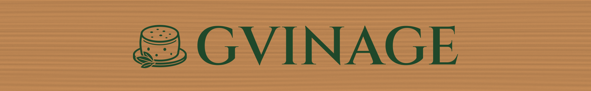

# שלט GVINAGE: קבצים לחריטת לייזר

שחזור של השלט שמעל המקרר: אייקון של גלגל גבינה על קרש הגשה ולידו הכיתוב **GVINAGE**. הקבצים וקטוריים, במידות אמיתיות במילימטרים, והכיתוב כבר הומר לצורות. לא צריך להתקין שום פונט במחשב של המכונה.



## הקבצים

| קובץ | מתי להשתמש בו |
|---|---|
| `gvinage-artwork.svg` | **הקובץ הראשי.** רק הלוגו והכיתוב, ברוחב 990 × 133 מ"מ. מתאים ל-LightBurn, ל-xTool ול-LaserGRBL. |
| `gvinage-board-layout.svg` | אותו עיצוב, ממוקם על לוח בגודל 1800 × 280 מ"מ. המסגרת האדומה היא קו המתאר של הלוח, לצורך מיקום בלבד. |
| `gvinage-artwork.dxf`, `gvinage-board-layout.dxf` | אותו תוכן בפורמט DXF, ל-RDWorks ולתוכנות שלא קוראות SVG. שכבות: `ENGRAVE` לחריטה ו-`BOARD` לקו הלוח. |
| `gvinage-artwork-254dpi.png` | תמונה בשחור-לבן ברזולוציה של 10 פיקסלים למ"מ (254 DPI), לתוכנה שעובדת רק עם תמונות. |
| `preview.png` | הדמיה לאישור הלקוח לפני העבודה. |
| `source/` | הסקריפט שמייצר את כל הקבצים, והפונט Cinzel (רישיון OFL חופשי). |

## 1. קודם כול מודדים

המידות שבקבצים הן **הערכה מתוך התמונה**: לוח של בערך 180 × 28 ס"מ, ואותיות בגובה של בערך 11.5 ס"מ. לפני שחורטים צריך למדוד את הלוח האמיתי.

- בתמונה הלוגו והכיתוב תופסים בערך 55% מרוחב הלוח, והאותיות תופסות בערך 40% מגובה הלוח. העיצוב ממורכז בלוח.
- **שינוי גודל ב-LightBurn:** מסמנים הכול (Ctrl+A), מוודאים שהמנעול של יחס הגובה-רוחב סגור, ומקלידים את הרוחב הרצוי בשדה Width. הקובץ וקטורי, ולכן הוא לא מאבד איכות בהגדלה או בהקטנה.
- אפשר גם לייצר מחדש את כל הקבצים במידות מדויקות (ראו בסוף המסמך).

## 2. איך מקבלים את המראה של המקור (אותיות ירוקות בתוך העץ)

השיטה: חורטים דרך מסקינג טייפ, צובעים כשהטייפ עדיין על העץ, ובסוף מקלפים אותו.

1. **הכנת הלוח:** משייפים לגרעין 180–240 ומנקים את האבק. אם צובעים או משמרים את העץ בגוון, עושים את זה עכשיו ומחכים שייבש. כדאי למרוח שכבה אחת של לכה שקופה או שלק (sanding sealer). השכבה הזו מונעת מהצבע הירוק לזלוג לתוך סיבי העץ מסביב לאותיות.
2. **מיסוך:** מדביקים על אזור החריטה מסקינג טייפ רחב מ**נייר** (application tape או טייפ של צבעים). מחליקים היטב כדי שלא יישארו בועות. ⚠️ **אסור להשתמש בוויניל או ב-PVC.** בחריטה הם משחררים גז כלור רעיל שגם הורס את המכונה.
3. **חריטה** לפי ההגדרות שבסעיף 3. הלייזר שורף את הטייפ וחורט את העץ שמתחתיו.
4. **צביעה:** בלי להוריד את הטייפ, מרססים צבע ירוק בשכבות דקות (2–3 שכבות, עם זמן ייבוש ביניהן). הגוון בתמונה הוא ירוק בקבוק כהה, קרוב ל-**RAL 6005** או ל-RAL 6009.
5. **קילוף:** אחרי שהצבע יבש, מקלפים את הטייפ ונשארות אותיות ירוקות נקיות. אם צריך, מיישרים בעדינות עם נייר שיוף 320.
6. **גימור:** מורחים לכה שקופה מט על כל הלוח.

> חלופה בלי טייפ: חורטים, ממלאים את החריטה בצבע במכחול, ואחרי הייבוש משייפים את פני הלוח עד שהצבע נשאר רק בתוך החריטה. השיטה עובדת טוב רק על עץ שעבר אטימה.

## 3. הכנת הקובץ ב-LightBurn, צעד אחר צעד

1. **File → Import** ובוחרים את `gvinage-artwork.svg`. בשורת המידות למעלה בודקים שהרוחב הוא 990 מ"מ, או המידה שקבעתם. אם המידה יוצאת אחרת, מקלידים אותה ידנית כשהמנעול סגור.
2. **שכבות:** כל העיצוב נכנס לשכבה **שחורה (C00)**. לוחצים עליה פעמיים ומגדירים:
   - **Mode: Fill** (מילוי. **לא Line**, אחרת הלייזר יעבור רק על קווי המתאר)
   - **Line Interval:** 0.1 מ"מ. בערך של 0.15 מ"מ העבודה מהירה בשליש, וכשממלאים את החריטה בצבע ההבדל לא נראה.
   - **Bi-directional fill:** מופעל
   - **Overscanning:** מופעל
   - **Fill Grouping → Fill shapes individually:** כל אות נחרטת בנפרד. ההגדרה הזו חוסכת המון זמן, כי הראש לא סורק את הרווחים שבין האותיות.
   - אם משתמשים ב-`gvinage-board-layout.svg`: המסגרת האדומה נמצאת בשכבה **C02**. מכבים לה את **Output**, כדי שהמכונה לא תחתוך את קו הלוח. אפשר להשאיר אותה פעילה רק אם רוצים לחתוך את הלוח עצמו והוא נכנס במכונה.
3. **עוצמה ומהירות.** אלה ערכי התחלה בלבד. תמיד מריצים קודם בדיקה על פיסת עץ מאותו סוג ועם אותו טייפ (Laser Tools → Material Test):
   - **CO2 בהספק 40–60W:** מהירות 250–350 מ"מ/שנייה, עוצמה 40%–55%, מעבר אחד או שניים. עומק של 0.5–1 מ"מ מתאים לצביעה.
   - **CO2 בהספק 80–100W:** מהירות 350–450 מ"מ/שנייה, עוצמה 30%–40%.
   - **לייזר דיודה (10–20W):** מהירות 60–120 מ"מ/שנייה, עוצמה 80%–100%, שני מעברים. בגודל הזה זו עבודה ארוכה מאוד (ראו זמנים בהמשך).
4. **פוקוס** על פני הלוח, כלומר על הטייפ. **Air Assist** מופעל, והיניקה מופעלת.
5. **מיקום:** מגדירים Start From: **Current Position**, מזיזים את הראש לנקודה הרצויה בלוח ולוחצים **Frame** כדי לראות בדיוק איפה ייחרט העיצוב. ממשיכים רק אחרי שהמסגרת יושבת במקום.
6. **Start**. ⚠️ לא משאירים את המכונה לבד: עץ עם נייר עלול להתלקח.

**זמן חריטה משוער** (מעבר אחד, גודל 990 מ"מ):
- CO2 ב-300 מ"מ/שנייה עם מרווח 0.1: כשעה ורבע. עם מרווח 0.15: כ-50 דקות.
- דיודה ב-80 מ"מ/שנייה: כ-4.5 שעות.

### תוכנות אחרות
- **xTool Creative Space:** מייבאים את קובץ ה-SVG, בוחרים לכל העיצוב **Engrave** ולא Score או Cut, ומשתמשים באותם ערכים.
- **RDWorks** (בקר Ruida): מייבאים את `gvinage-artwork.dxf` דרך File → Import. בשכבה בוחרים **Scan** ומגדירים Interval של 0.1 מ"מ. מוודאים ש-Scan ממלא את הצורות הסגורות.
- **LaserGRBL:** מייבאים את `gvinage-artwork.svg`. אם יש בעיה, מייבאים את ה-PNG, קובעים רוחב של 990 מ"מ ורזולוציה של 10 קווים למ"מ, ובוחרים במצב Line To Line.

## 4. אם הלוח גדול יותר ממשטח העבודה

העיצוב ברוחב 990 מ"מ נכנס במכונות עם משטח של 1300 × 900 מ"מ. במכונה קטנה יותר יש כמה אפשרויות:

- **חריטה בחלקים:** כל אות היא צורה נפרדת בקובץ. מסמנים רק חלק מהאותיות, למשל את האייקון ואת GVI, ומפעילים **Cut Selected Graphics**. אחר כך מזיזים את הלוח ומסמנים את NAGE. כדי שהשורה תצא ישרה, מהדקים סרגל ישר או קרש (fence) לאורך המשטח ומחליקים את הלוח לאורכו. את המיקום של כל חלק בודקים עם **Frame**.
- **מכונה עם פתח מעבר (pass-through):** מעבירים את הלוח דרך הפתח וחורטים בשלבים.
- **הקטנה:** אם הלקוח מסכים, מקטינים את העיצוב.

## 5. כמה זה נאמן למקור

- **הפונט:** Cinzel SemiBold, פונט רומי קלאסי בסגנון Trajan, כמו בשלט שבתמונה. ייתכן שהמקור נעשה ב-Trajan או בפונט דומה. בגודל הזה ההבדל כמעט לא מורגש.
- **האייקון:** בתמונה האייקון קטן מאוד, ולכן הוא צויר מחדש לפי התמונה: גלגל גבינה עם חורים, על קרש הגשה עגול, עם ענף עלים בצד. הוא דומה למקור, אבל לא זהה לו פיקסל לפיקסל.
- אם ללקוח יש את קובץ הלוגו המקורי (AI, PDF, SVG או EPS), עדיף להשתמש בו.

## ייצור מחדש במידות אחרות

```bash
pip install fonttools skia-pathops uharfbuzz shapely ezdxf cairosvg pillow numpy
python3 source/make_sign.py --board-width 1800 --board-height 280 --art-width 990
# או לפי גובה האותיות:
python3 source/make_sign.py --cap-height 110
```

הסקריפט מעדכן את כל הקבצים בתיקייה ומדפיס את המידות ואת זמני החריטה המשוערים.
