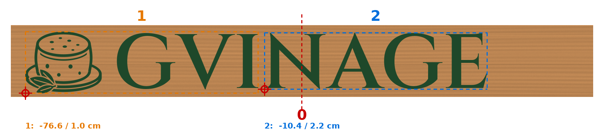

# GVINAGE: לוח בגובה 20 ס"מ, אותיות בגובה 15 ס"מ

## הקבצים לתוכנה של המכונה (LaserCut / N.T.N.tech)

כל חלק שמור בארבעה פורמטים. כולם באותו גודל ומכילים את אותו ציור:

| חלק | מה יש בו | גודל | קבצים |
|---|---|---|---|
| 1 | הלוגו + **GVI** | 644.8 × 171.6 מ"מ | `gvinage-part1.ai`, `gvinage-part1.dxf`, `gvinage-part1.plt`, `gvinage-part1.bmp` |
| 2 | **NAGE** | 616.3 × 156.9 מ"מ | `gvinage-part2.ai`, `gvinage-part2.dxf`, `gvinage-part2.plt`, `gvinage-part2.bmp` |

### אם הקובץ לא נכנס לתוכנה

1. **ייבוא ולא פתיחה:** משתמשים ב**קובץ → ייבוא** (Ctrl+I), לא ב**קובץ → פתח**. "פתח" פותח רק את הקבצים של התוכנה עצמה, ובקובץ אחר מקבלים מסך ריק.
2. **סוג הקובץ בחלון:** בתחתית חלון הייבוא יש רשימה של סוגי קבצים. בוחרים בה AI, ‏DXF, ‏PLT, ‏BMP או "כל הקבצים". אחרת הקובץ לא מופיע ברשימה.
3. **סדר הניסיון:** קודם `.ai`, אחר כך `.dxf`, אחר כך `.plt`, ובסוף `.bmp`. קובץ ה-AI שמור בגרסה הישנה של Illustrator ‏(8), כמו שגרפיקאים שומרים בשביל תוכנות לייזר. קובץ ה-BMP הוא תמונה בשחור-לבן ברזולוציה של 0.1 מ"מ, ותמונה אפשר רק לחרוט. במקרה הזה זה בדיוק מה שצריך.
4. **בדיקת גודל:** אחרי הייבוא בודקים שהגודל על המסך תואם לטבלה. אם לא, משנים אותו ידנית ושומרים על היחס בין הרוחב לגובה.

התיקייה `other-formats` מיועדת לתוכנות אחרות בלבד, ואפשר להתעלם ממנה: יש בה DXF 2000 ו-SVG.

## למה שני חלקים

כל העיצוב יחד הוא 127.8 ס"מ, ושטח העבודה של המכונה הוא 90 × 60 ס"מ. לכן העיצוב מחולק לשני חלקים. החלוקה עוברת ברווח שבין I ל-N, כך שאף אות לא נחתכת.

**אורך הלוח צריך להיות לפחות 161 ס"מ.** הכיתוב באמצע הלוח והלוגו בולט שמאלה, ובלוח קצר יותר הלוגו ייצא מהלוח.

## איפה כל חלק יושב על הלוח

המיקום נמדד מ**קו האמצע** של הלוח ומה**קצה התחתון** שלו:

- **חלק 1:** הפינה השמאלית התחתונה שלו נמצאת 76.6 ס"מ שמאלה מקו האמצע ו-1.0 ס"מ מעל הקצה התחתון.
- **חלק 2:** הפינה השמאלית התחתונה שלו נמצאת 10.4 ס"מ שמאלה מקו האמצע ו-2.2 ס"מ מעל הקצה התחתון. בין ה-I ל-N נשאר רווח של 1.7 ס"מ.

## שלבים

1. **ייבוא:** בתפריט **קובץ → ייבוא** (Ctrl+I) בוחרים את `gvinage-part1.ai`. אם הוא לא נכנס, מנסים את ה-DXF, ה-PLT או ה-BMP. בודקים שהגודל על המסך הוא 644.8 × 171.6 מ"מ.
2. **שכבה:** הכול נכנס לשכבה **השחורה** בטבלה שמימין. לוחצים עליה פעמיים ומגדירים:
   - **תהליך:** **חריטה** (Engrave), **לא** חיתוך.
   - **מהירות:** 250 מ"מ/שנייה.
   - **עוצמה:** בסביבות 40%–55%.
   - **מרווח סריקה:** 0.1 מ"מ.
   - לפני כן מריצים בדיקה קצרה על שארית מאותו עץ, עם הטייפ.
3. **מיקום:** מניחים את הלוח במכונה וגוררים את העיצוב על המסך למקום שבו הלוח מונח. המסך מייצג את משטח המכונה. הקצה התחתון של הלוח צריך להיות ישר ומקביל לציר X.
4. **בדיקה:** אם במכונה יש כפתור שמריץ את הראש סביב המסגרת של העבודה, משתמשים בו כדי לוודא שהעיצוב יושב במקום.
5. **התחלה.**
6. **חלק 2:** מוחקים את חלק 1 מהמסך, מזיזים את הלוח שמאלה בלי לסובב אותו, מייבאים את `gvinage-part2` באותו פורמט שעבד בחלק 1 וחוזרים על שלבים 2–5.

**זמן:** כשעה ורבע לחלק 1 וכשעה ורבע לחלק 2, במעבר אחד ב-250 מ"מ/שנייה.

**צבע ירוק:** מרססים כשהטייפ עדיין על הלוח, ומקלפים רק אחרי שהצבע יבש. הפירוט נמצא ב-[README הראשי](../README.md).

⚠️ לא משאירים את המכונה לבד בזמן העבודה.
